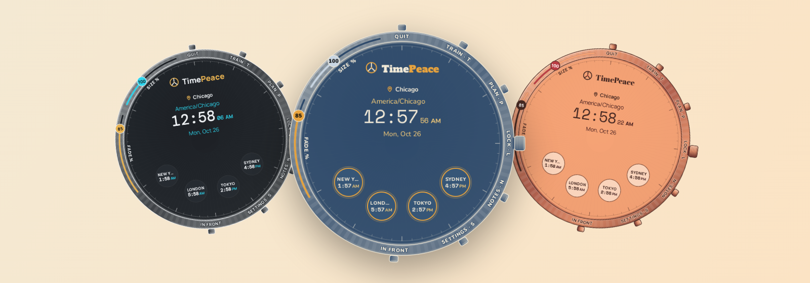
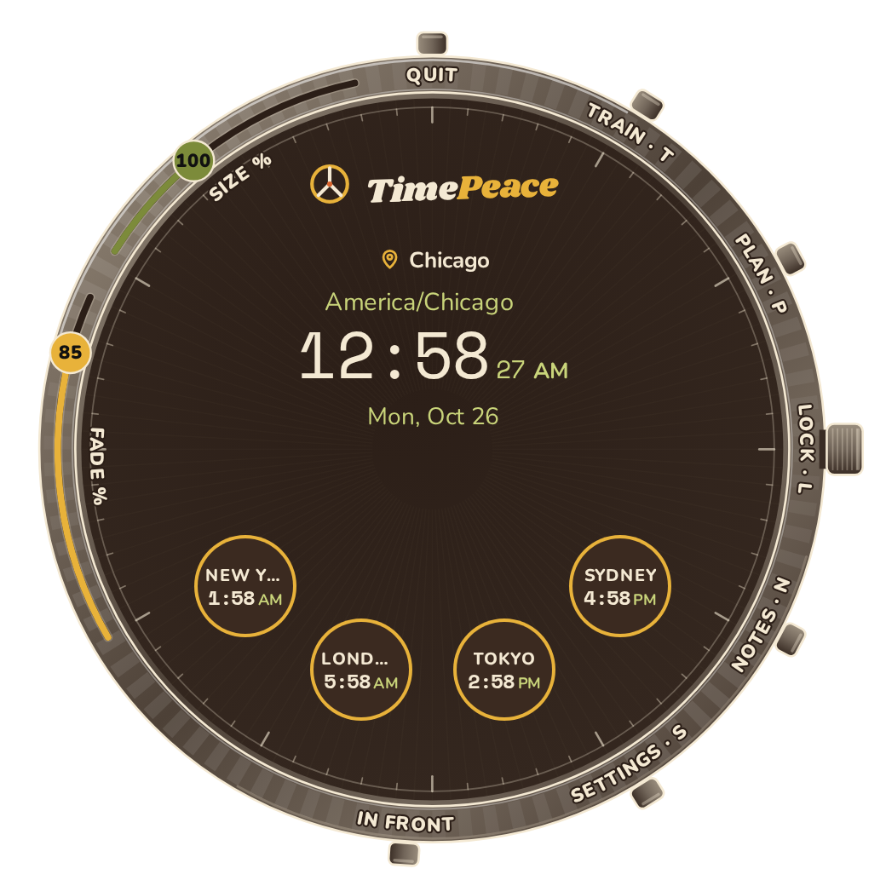
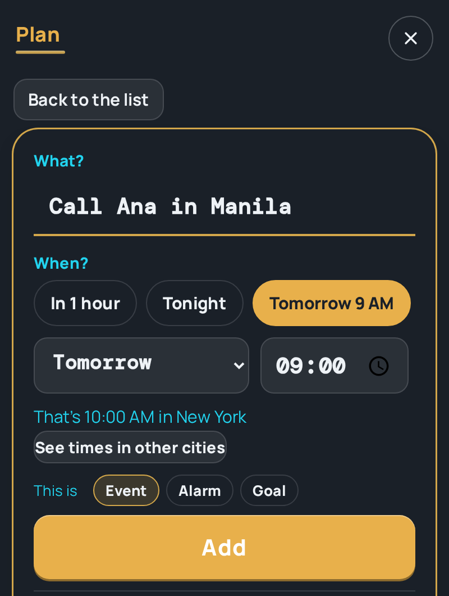
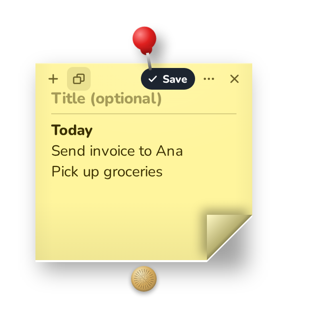
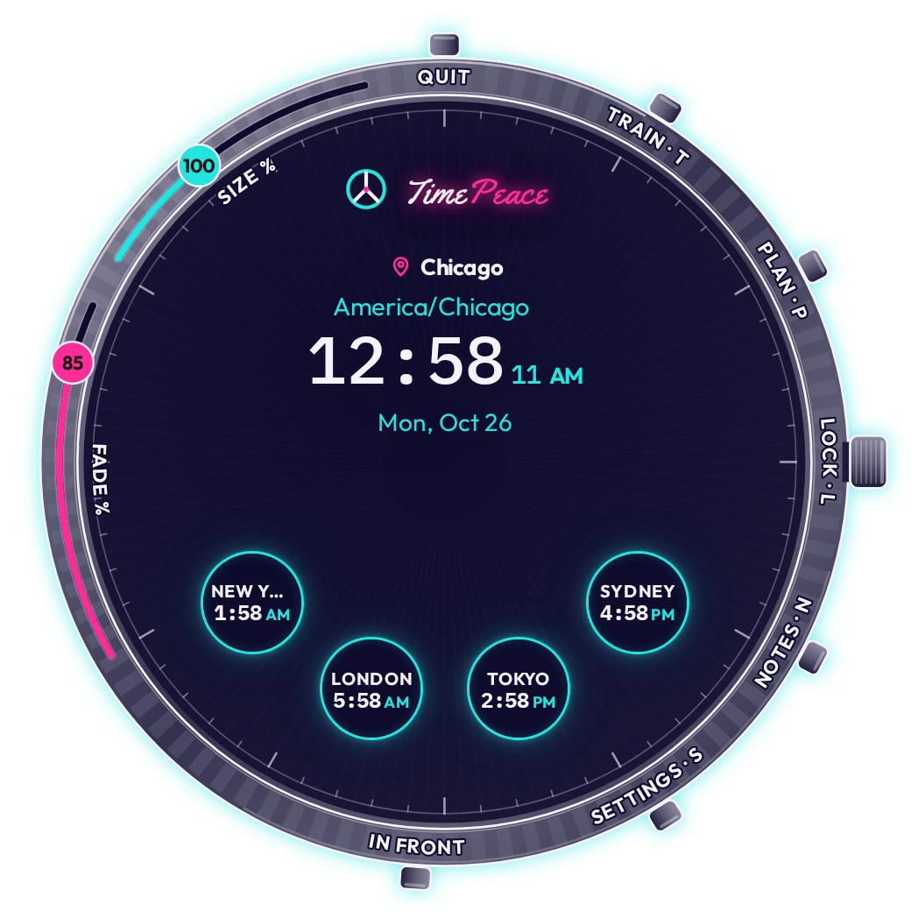

<picture>
  <source media="(prefers-color-scheme: dark)" srcset="assets/banner-dark.png">
  
</picture>

<h1 align="center">TimePeace</h1>
<h3 align="center">Every city you care about, on one watch face that sits on your desktop.</h3>

 Also for <a href="https://github.com/PythonDeuce/TimePeace-app/releases/latest/download/TimePeace-macos-arm64.zip">Mac (Apple silicon)</a> · <a href="https://github.com/PythonDeuce/TimePeace-app/releases/latest/download/TimePeace-macos-intel.zip">Mac (Intel)</a> · <a href="https://github.com/PythonDeuce/TimePeace-app/releases/latest/download/TimePeace-linux">Linux</a>

## Everything at a glance

| Feature | What it does | |
|---|---|:-:|
| **Watch face** | Your city in the middle, other cities around it, large time and date |  |
| **Plan** | Name it, pick a time, press Add. Every city lines up. |  |
| **Alarms** | Pops up in front of every window and rings until you press Dismiss or Snooze | ⏰ |
| **Sticky notes** | Pin anywhere on screen; talk into the microphone, dictation runs on your computer |  |
| **Looks** | 15 themes, 18 animated layouts and a few classic ones |  |
| **Settings** | A side rail of plain panes (Look, Clocks, Notes, Desktop, Shortcuts, Voice typing, About) with a search box |  |
| **Trainer** | A military time trainer | 🎖️ |

## 18 animated layouts

Small scenes move behind your clocks, and your cities sit in them: a honey cell, a flower, a planet, a lily pad. The **Animate layout** switch in Settings, Look turns the motion off and leaves a still picture.

  

## New in 1.11: a simpler Settings

Settings now has a side rail down the left, with Look, Clocks, Notes, Desktop, Shortcuts, Voice typing and About, and a search box on top that jumps to any setting.

## Install in 3 steps

1. **Download** `TimePeace-windows.exe` with the button above.
2. **Open it.** If Windows shows a blue *"Windows protected your PC"* box, click **More info**, then **Run anyway**. (TimePeace is not code signed, so Windows asks once.)
3. **Make it yours.** Add your cities, pick a look, and drag the clock where you want it.

## Downloads

| System | File |
|---|---|
| **Windows** | [TimePeace-windows.exe](https://github.com/PythonDeuce/TimePeace-app/releases/latest/download/TimePeace-windows.exe) |
| Mac, Apple silicon (M1 and later) | [TimePeace-macos-arm64.zip](https://github.com/PythonDeuce/TimePeace-app/releases/latest/download/TimePeace-macos-arm64.zip) |
| Mac, Intel | [TimePeace-macos-intel.zip](https://github.com/PythonDeuce/TimePeace-app/releases/latest/download/TimePeace-macos-intel.zip) |
| Linux | [TimePeace-linux](https://github.com/PythonDeuce/TimePeace-app/releases/latest/download/TimePeace-linux) |

---

<a href="https://github.com/PythonDeuce/TimePeace-app/blob/main/TROUBLESHOOTING.md">Help and troubleshooting</a> · <a href="PRIVACY.md">Privacy</a> · <a href="LICENSE">License</a> · <a href="https://github.com/PythonDeuce/TimePeace-app/releases">All releases</a>

TimePeace is an EABA product. It goes online only for the daily update check and, if you use dictation, a one time speech model download.

